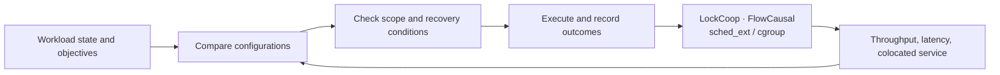

<p align="center">
  
</p>

<p align="center">
  <a href="README.md">中文</a> · <strong>English</strong><br>
  <a href="docs/README.en.md">Documentation</a> · <a href="docs/quickstart.en.md">Get started</a> · <a href="docs/benchmarks.md">Results &amp; data</a> · <a href="presentation/">Slides</a> · <a href="CONTRIBUTING.en.md">Contribute</a>
</p>

# KernAdapt

**Adaptive Linux resource control for mixed workloads.**

More CPU time does not always mean faster application progress. A database transaction may wait for a lock holder; a code tool may wait for a particular child process. These dependencies help determine which runnable task matters next.

KernAdapt connects application dependencies and service objectives to resource decisions. A user-space control plane compares configurations and manages execution and recovery. Kernel mechanisms built on `sched_ext` handle individual scheduling events. You can explore the offline control flow or work with LockCoop and FlowCausal independently.

## What it provides

| Workload | Mechanism | Implementation |
| --- | --- | --- |
| Databases with lock contention and expensive handoffs | **LockCoop** combines bounded lock-holder timeslice extensions with CPU placement informed by per-lock execution history | [LockCoop](src/lockcoop/) |
| Concurrent code-tool workflows sharing CPUs | **FlowCausal** identifies actual blocking dependencies and provides bounded early service within each session's share | [FlowCausal](src/flowcausal/) |
| Mixed workloads with throughput, latency, and colocated-service objectives | **KernAdapt's control plane** compares configurations, checks execution scope, records outcomes, and manages recovery | [Control plane](src/agent/) |

## Quick start

The offline demo requires **Python 3.10+**. It uses synthetic inputs with the project's policy checks and persistent runtime. No root privileges, model API, or `sched_ext` kernel are needed.

```bash
git clone https://github.com/Lss-lmj/kernadapt-industry-2026.git kernadapt
cd kernadapt
python3 demo/run_demo.py --out results/demo
```

A successful run ends with `DEMO PASS`. Inspect:

| Output | Contents |
| --- | --- |
| `results/demo/summary.json` | Decisions, capability checks, and execution stages |
| `results/demo/guard_*.json` | Policy checks for valid and invalid inputs |
| `results/demo/runtime/` | SQLite state, events, and artifact indexes |

The final stage also summarizes archived measurements. **This demo exercises control flow; its performance figures come from existing experiment records.** See the [archived output](tests/results/demo-output.txt) and [getting-started guide](docs/quickstart.en.md).

## Architecture



Configuration decisions and kernel scheduling operate at different time scales. Model policies propose structured configurations; per-task scheduling does not wait for model responses. Persistent records connect each decision to its inputs, actions, and measured outcomes.

[Architecture and source map](docs/architecture.md) · [Environment and build instructions](docs/quickstart.en.md)

## Reported results

| Experiment | Baseline | Result | Source |
| --- | --- | --- | --- |
| LockCoop, ARM64 node 0, MariaDB with 256 threads | `scx_simple` | **5.30×** throughput; **84.8%** lower p95 latency | [Platform and batches](docs/benchmarks.md#lockcoop) |
| LockCoop, unbound x86, MariaDB with 256 threads | `scx_simple` | **4.14×** throughput; **82.2%** lower p95 latency | [Platform and batches](docs/benchmarks.md#lockcoop) |
| LockCoop, unbound RISC-V, MariaDB with 256 threads | `scx_simple` | **2.15×** throughput; **56.6%** lower p95 latency | [Platform and batches](docs/benchmarks.md#lockcoop) |
| KernAdapt, 560 configuration-selection groups | Factorized GBDT | Mean regret **0.04357**, reduced by **30.95%** | [Configuration selection](docs/benchmarks.md#kernadapt) |
| KernAdapt, 600 independent decisions | Retain the Linux configuration | **147** adjustments, **114** with positive utility | [Decision execution](docs/benchmarks.md#kernadapt) |
| FlowCausal, 4 CPUs, 8 workflows, 3 rounds | Native Linux | Mean completion time **−7.32%**; makespan **+2.65%** | [Workflow results](docs/benchmarks.md#flowcausal) |

Throughput ratios, selection regret, and workflow completion time answer different questions. The ARM64 and x86 report summaries include later mechanism measurements. The [results guide](docs/benchmarks.md) identifies the source files, configurations, and batches, including comparisons that can be reconstructed within one batch.

## Explore the project

| Goal | Start here |
| --- | --- |
| Evaluate the software on your machine | [Get started](docs/quickstart.en.md) → [architecture](docs/architecture.md) |
| Extend a mechanism or fix an issue | [Source modules](src/) → [contribution guide](CONTRIBUTING.en.md) |
| Study or reproduce the results | [Technical reports](papers/README.md) → [data and methodology](docs/benchmarks.md) |
| Present the project | [58-slide deck and speaker notes](presentation/) · [narrated video](videos/) |

```text
src/agent/        Configuration policies, execution, and persistent runtime
src/lockcoop/     Lock observations, BPF schedulers, loaders, and microbenchmarks
src/flowcausal/   Session registration, BPF schedulers, and workflow replay
src/analysis/    Experiment analysis
src/skills/      Policy applicability and parameter constraints
demo/            Offline control-flow example
scripts/         Build and engineering checks
tests/           Logic tests, experiment configurations, data, and records
docs/            Guides, architecture, and the full technical report
papers/          Mechanism reports and supplementary material
presentation/    Slides, PDF, and speaker notes
videos/          Narrated project presentation
```

## Contributing and citing

Platform reports, independent reproductions, interface improvements, and documentation fixes are welcome. See [contribution guidelines](CONTRIBUTING.en.md), [maintenance directions](ROADMAP.md), and the [issue templates](https://github.com/Lss-lmj/kernadapt-industry-2026/issues/new/choose).

Use [CITATION.cff](CITATION.cff) to cite the software and record the commit used in your work. The [research index](papers/README.md) connects reports to implementations and data.

## Team and licensing

Maintained by **OSKernel**. Affiliation: 智梦云创（杭州）科技有限公司/中国科学院大学.

The original control plane and corresponding documentation use [MIT](LICENSE). Scheduler and synchronization files retain their individual SPDX identifiers, including GPL and LGPL terms. See the [licensing notes](docs/第三方依赖与工具说明.md) and each source header.

[2026 competition archive](docs/events/oa2026.md) · [Changelog](CHANGELOG.md)
