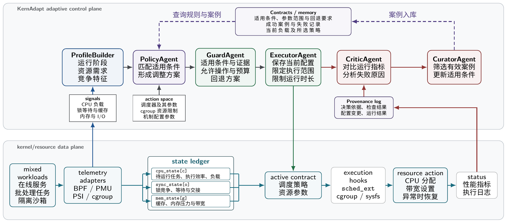

# KernAdapt：面向混合负载的自适应内核资源管控 Agent

[代码仓库](https://github.com/Lss-lmj/kernadapt-industry-2026) · [演示视频](https://github.com/Lss-lmj/kernadapt-industry-2026/releases/download/oa2026-submission/KernAdapt-industry-demo.mp4) · [提交版本与附件](https://github.com/Lss-lmj/kernadapt-industry-2026/releases/tag/oa2026-submission)

参赛团队：OSKernel  
申报单位：智梦云创（杭州）科技有限公司/中国科学院大学

KernAdapt 面向数据库与工具工作流提供 Linux 内核调度和资源优化能力，结合 LockCoop、FlowCausal 和资源配置控制面改善任务执行。

## 阅读入口

- [作品介绍 PDF](docs/项目文档.pdf) · [章节导航](docs/项目文档.md)
- [答辩 PPTX](presentation/答辩演示.pptx) · [答辩 PDF](presentation/答辩演示.pdf) · [逐页讲稿](presentation/逐页讲稿.md)
- [构建与运行](docs/构建与运行.md) · [代码索引](docs/代码与脚本索引.md)
- [演示视频](docs/演示视频入口.md) · [演示脚本](docs/演示视频脚本.md)

## 代码与脚本

本仓库包含 KernAdapt 控制面、LockCoop 和 FlowCausal 的现有实现、构建与演示脚本，以及实验配置、逐轮数据和归档记录。

```text
src/
  agent/                 KernAdapt 控制面、运行时服务与测试
  lockcoop/            LockCoop loader、BPF、同步观测与实验脚本
  flowcausal/            FlowCausal 登记程序、BPF、工作流回放与基准
  analysis/             实验分析脚本
  skills/               调度策略约束与配置
scripts/                工程构建、内核工具构建与检查入口
demo/                   控制面演示入口
tests/                  测试入口、实验配置、逐轮数据和归档记录
docs/                   设计文档与完整技术报告 PDF、构建及接口说明
presentation/           正式答辩 PPTX、PDF 和逐页讲稿
papers/                 技术论文与补充附录
Makefile                构建、测试、演示和结果核算入口
```

| 入口 | 用途 |
| --- | --- |
| [控制面](src/agent/) · [LockCoop](src/lockcoop/) · [FlowCausal](src/flowcausal/) | 三项核心实现 |
| [代码与脚本索引](docs/代码与脚本索引.md) | 主要程序、构建脚本和实验入口 |
| [Makefile](Makefile) · [构建脚本](scripts/build.py) · [内核构建脚本](scripts/build-kernel.sh) | 基础程序与匹配内核工具的构建 |
| [演示说明](demo/README.md) · [演示入口](demo/run.sh) | 现有控制流程演示 |
| [测试与数据](tests/README.md) · [实验结果来源](docs/实验结果来源.md) | 原工程测试方法、配置和实验记录 |

## 使用入口

在仓库根目录运行下列现有入口，环境和依赖见[构建与运行](docs/构建与运行.md)：

```bash
make build
make demo
make test-all
make verify-results
```

真实调度器构建使用与目标环境匹配的完整 Linux 内核工作树：

```bash
KERNEL_SRC=/path/to/linux ./scripts/build-kernel.sh
```

## 核心机制

| 组成 | 作用 |
| --- | --- |
| KernAdapt | 根据状态与目标比较结构化配置，进行约束检查、执行、效果评价和恢复 |
| LockCoop | 将逐锁依赖用于持锁者推进和同锁后继 CPU 放置 |
| FlowCausal | 根据实际工具返回关系安排会话内执行，核算会话服务 |



## 实验结果

256 线程 MariaDB OLTP 相对同机 scx_simple：openEuler ARM64 节点 0 吞吐 **5.30 倍**、p95 降低 **84.8%**；x86 全机不绑定 **4.14 倍**、p95 降低 **82.2%**；RISC-V 全机不绑定 **2.15 倍**、p95 降低 **56.6%**。CPU 干扰下，相对仅启用 LockNest 的吞吐增加 **9.6%–36.1%**，批处理工作量差异不超过 **0.53%**。[LockCoop 论文](papers/E1-LockCoop.pdf)

KernAdapt 组合预测包含 **560 组、2,800 次动作执行**，平均 regret **0.04357**，比因子化 GBDT 低 **30.95%**。独立 **600 次决策**中执行 **147 次**，其中 **114 次正收益**；其余 **453 次保持 Linux**。全部决策平均效用为 **0.01398**，95% CI **[0.01094, 0.01694]**。两组实验的模型与统计任务分别解释。[KernAdapt 论文](papers/E2-KernAdapt.pdf)

FlowCausal 在 4 CPU、8 个工作流的三轮交错回放中，平均完成时间降低 **7.32%**，全部完成时间增加 **2.65%**。[FlowCausal 论文](papers/E3-FlowCausal.pdf)

## 源码与使用

源码已包含在本仓库。源码目录、构建依赖和具体操作见[源码与文档对应关系](docs/源码与文档对应关系.md)和[构建与运行](docs/构建与运行.md)。真实内核执行要求兼容的 sched_ext/BTF 与管理权限；流程演示按其输入和运行方式单独标注。

## 开源协作

[贡献指南](CONTRIBUTING.md) · [治理规则](GOVERNANCE.md) · [维护计划](ROADMAP.md) · [依赖与工具说明](docs/第三方依赖与工具说明.md)

根目录 [MIT 许可](LICENSE) 适用于对应原创控制面和文档；源文件保留各自 SPDX 和上游版权，内核与观测库遵循相应文件级许可。
