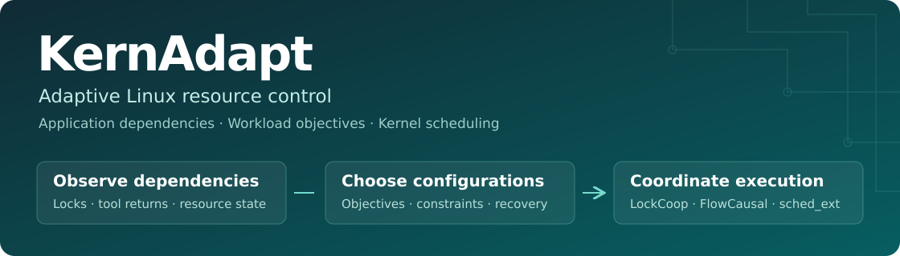

<p align="center">
  
</p>

<p align="center">
  <strong>中文</strong> · <a href="README.en.md">English</a><br>
  <a href="docs/README.md">文档</a> · <a href="docs/构建与运行.md">开始使用</a> · <a href="docs/benchmarks.md">实验数据</a> · <a href="presentation/">技术演示</a> · <a href="CONTRIBUTING.md">参与贡献</a>
</p>

# KernAdapt

**面向混合负载的自适应 Linux 内核资源管控。**

共享一台机器时，应用获得更多 CPU 时间，并不一定更快完成工作。数据库可能在等待持锁线程释放锁，代码工具可能在等待某个子进程返回；这些依赖决定了此刻让谁运行更有价值。

KernAdapt 将应用依赖、服务目标和资源配置联系起来：控制面比较配置、管理执行与恢复；基于 `sched_ext` 的调度机制在内核中处理逐任务调度。可以从离线控制流程入手，也可以单独研究和使用 LockCoop、FlowCausal。


## 项目材料

| 材料 | 内容 | 阅读与下载 |
| --- | --- | --- |
| 项目演示 | 57 页 PPT，含逐页讲稿及对应视频 | [PPTX](presentation/答辩演示.pptx) · [PDF](presentation/答辩演示.pdf) · [视频](https://github.com/Lss-lmj/kernadapt-industry-2026/releases/download/oa2026-submission/KernAdapt-industry-demo.mp4) |
| 作品说明书 | 90 页，应用场景、八章技术内容和实验分析 | [PDF](docs/作品说明书.pdf) |
| 开发设计文档 | 14 页，总体设计、模块、流程、接口和系统接入 | [PDF](docs/开发设计文档.pdf) |


## 能解决什么问题

| 你的场景 | 项目提供的机制 | 阅读入口 |
| --- | --- | --- |
| 数据库高并发下，锁等待、线程迁移和尾延迟增加 | **LockCoop**：解锁前有限延长持锁者时间片，唤醒后利用同一把锁的执行历史选择 CPU | [机制与实现](src/lockcoop/) |
| 多个代码工具工作流共享 CPU，关键子进程影响返回时间 | **FlowCausal**：确认实际阻塞依赖，在会话份额内安排短时间片提前运行 | [机制与实现](src/flowcausal/) |
| 混合负载需要按吞吐、延迟和共存任务约束调整配置 | **KernAdapt 控制面**：比较方案、检查作用范围、记录执行效果并恢复配置 | [控制面与接口](src/agent/) |

## 快速体验

离线演示只需要 **Python 3.10+**，使用合成输入运行项目中的策略检查和状态记录代码，无需 root、模型 API 或支持 `sched_ext` 的内核。

```bash
git clone https://github.com/Lss-lmj/kernadapt-industry-2026.git kernadapt
cd kernadapt
python3 demo/run_demo.py --out results/demo
```

完成后终端输出 `DEMO PASS`。打开以下文件查看过程：

| 输出 | 内容 |
| --- | --- |
| `results/demo/summary.json` | 策略决定、权限检查与运行步骤 |
| `results/demo/guard_*.json` | 有效配置、未知调度器等输入的处理结果 |
| `results/demo/runtime/` | SQLite 状态、事件记录和文件索引 |

演示末尾还会汇总仓库中的历史实验数据。**这里展示的是控制流程；性能数字来自归档实验。** [演示说明与输出示例](demo/README.md)

下一步：[构建与运行](docs/构建与运行.md) · [环境与兼容性](docs/compatibility.md) · [常见问题](docs/faq.md)

## 系统如何工作


控制面按配置调整的节奏运行；内核中的 BPF 调度器处理任务唤醒、运行和停止等事件。模型策略通过结构化配置参与决策，逐任务调度不等待模型响应。运行记录保留选择依据、动作和效果，便于分析一次调整为何有效或失效。

[系统架构与代码入口](docs/architecture.md) · [控制面架构图](docs/images/control.png) · [代码与脚本索引](docs/代码与脚本索引.md)

## 实验结果

以下为技术报告中的结果，每项都保留对应平台、基线和数据来源。

| 机制与场景 | 比较对象 | 结果 | 数据 |
| --- | --- | --- | --- |
| LockCoop，ARM64 节点 0，MariaDB 256 线程 | `scx_simple` | 吞吐 **5.30×**，p95 延迟降低 **84.8%** | [平台与批次](docs/benchmarks.md#lockcoop) |
| LockCoop，x86 全机，MariaDB 256 线程 | `scx_simple` | 吞吐 **4.14×**，p95 延迟降低 **82.2%** | [平台与批次](docs/benchmarks.md#lockcoop) |
| LockCoop，RISC-V 全机，MariaDB 256 线程 | `scx_simple` | 吞吐 **2.15×**，p95 延迟降低 **56.6%** | [平台与批次](docs/benchmarks.md#lockcoop) |
| KernAdapt，560 组组合配置预测 | 因子化 GBDT | 平均 regret **0.04357**，降低 **30.95%** | [配置选择](docs/benchmarks.md#kernadapt) |
| KernAdapt，600 次独立决策 | 保持 Linux 原配置 | 执行 **147** 次调整，**114** 次正收益 | [决策与执行](docs/benchmarks.md#kernadapt) |
| FlowCausal，4 CPU、8 个工作流、3 轮 | 原生 Linux | 平均完成时间降低 **7.32%**，全部完成时间增加 **2.65%** | [工作流结果](docs/benchmarks.md#flowcausal) |

吞吐倍数、配置选择的 regret 和工作流完成时间衡量不同问题。论文汇总中的 ARM64、x86 数字含后续机制复测；[结果说明](docs/benchmarks.md)列出具体文件和批次，便于复算和选择对照。

## 按目标阅读

| 目标 | 建议路线 |
| --- | --- |
| 评估能否用于自己的系统 | [场景与环境](docs/compatibility.md) → [构建运行](docs/构建与运行.md) → [集成与测量](docs/integration.md) |
| 理解实现或扩展调度机制 | [架构](docs/architecture.md) → [代码索引](docs/代码与脚本索引.md) → [贡献指南](CONTRIBUTING.md) |
| 研究算法与复现实验 | [技术报告](papers/README.md) → [数据与统计方法](docs/benchmarks.md) → [实验入口](tests/README.md) |
| 做技术交流或演示 | [57 页演示文稿与讲稿](presentation/) · [配音演示视频](videos/) |

## 仓库结构

```text
src/agent/        配置选择、执行管理与持久化运行时
src/lockcoop/     锁观测、BPF 调度器、用户态加载器和微基准
src/flowcausal/   会话登记、BPF 调度器与工具工作流回放
src/analysis/    实验分析脚本
src/skills/      调度策略的适用条件与参数约束
demo/            离线控制流程演示
scripts/         构建与工程检查入口
tests/           逻辑测试、实验配置、逐轮数据和归档记录
docs/            使用说明、架构、作品说明书和开发设计文档
papers/          专题技术报告与补充材料
presentation/    演示文稿、PDF 与讲稿
videos/          配音演示视频
```

## 参与项目

欢迎提交平台运行记录、复现实验、接口改进和文档修订。初次贡献可以从[具体任务与维护方向](ROADMAP.md)开始；性能问题请附基线、配置和逐轮结果，方便其他人复现。

[报告问题](https://github.com/Lss-lmj/kernadapt-industry-2026/issues/new/choose) · [贡献指南](CONTRIBUTING.md) · [维护方式](GOVERNANCE.md) · [版本记录](CHANGELOG.md)

研究中使用本项目时，可使用 [CITATION.cff](CITATION.cff) 引用软件，并记录实际使用的提交版本。技术报告、数据和代码之间的对应关系见[研究资料](papers/README.md)。

## 团队与许可

由 **OSKernel** 团队维护。

原创控制面及相应文档使用 [MIT](LICENSE)；内核调度器和同步观测库按各文件的 SPDX 标识保留 GPL、LGPL 等许可。具体范围见[依赖与许可](docs/第三方依赖与工具说明.md)。

[技术文档与演示材料](docs/README.md)
