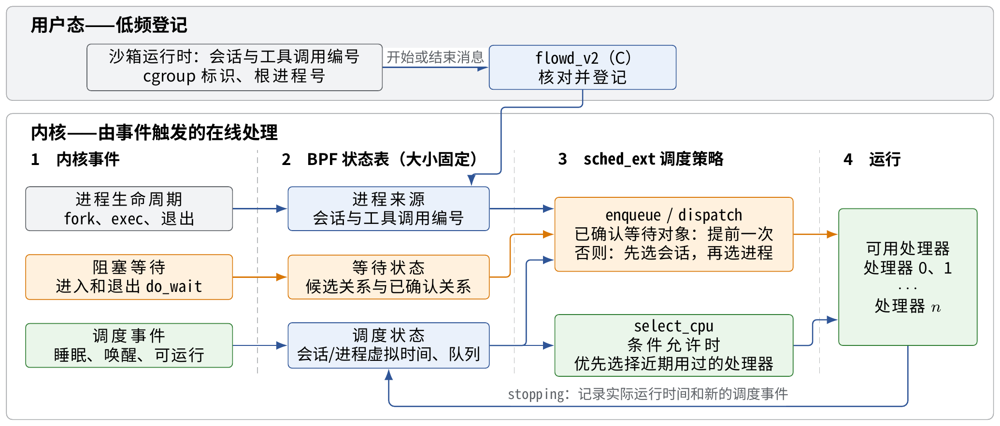
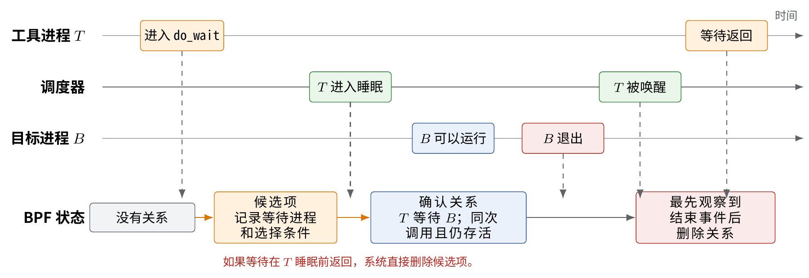
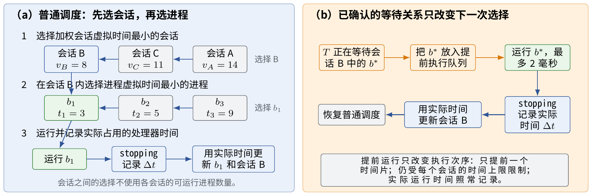
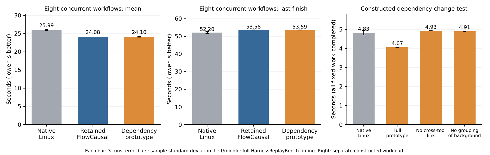

# FlowCausal

利用工具返回关系调度并发代码智能体工作流。每个会话使用独立的控制组（cgroup），将同一工作流的进程归为一组。C 程序登记 cgroup、会话与工具调用，BPF 跟踪 fork、实际阻塞等待、唤醒和退出；根据当前工具返回所依赖的进程安排有限的提前运行。



## 工具返回关系与公平调度

调用 wait 系统调用不等于已经阻塞，进程父子关系也不等于当前返回依赖。FlowCausal 结合调度事件确认真正的阻塞，并在等待结束、任务退出和工具代际变化时更新关系。在线路径不依赖 Python 轮询或扫描 `/proc`。



外层按会话虚拟时间组织公平服务，内层对已确认的工具返回依赖提供短时间片提前运行；实际 CPU 服务计入所属会话，并继续受配额、并行运行限制和提前预算约束。



## 系统实现与实验

- 在线调度由事件触发，通过工具返回关系安排会话内的进程，并按会话分配 CPU 份额。
- 本地 futex 唤醒的提前额度受实际睡眠时间约束；修正临时权重期间的 CPU 服务结算和最后一个可运行任务 yield 后的重新分派。
- HarnessReplayBench 包含 50 个公开任务、42 个仓库和 2940 条工具命令；四会话与八工作流实验使用各自固定的配置并分别统计。
- 独立研究旧命令后台进程成为当前 waitpid 对象后的排队修正，保留完整实验原型与消融源码。

在 4 个 CPU、8 个并发工作流的对照中，每种方案交错运行 3 轮。FlowCausal 的平均工作流完成时间由原生 Linux 的 **25.986 s** 降至 **24.084 s**，降低 **7.32%**；全部完成时间由 **52.201 s** 增至 **53.584 s**，增加 **2.65%**。

独立的跨命令依赖原型在 4 CPU、8 个后台进程的固定工作量消融中，将平均完成时间从 **4.828 s** 降至 **4.065 s**，降低 **15.79%**。该机制在上述八工作流回放中未带来额外收益，因此单独列为实验原型。



原型微基准包含固定计算量和 2 秒模拟非 CPU 阶段，完成时间计入所有后台工作。它不包含真实模型推理、远程接口等待或完整应用启动成本。性能统计仅使用实际调度器与计划一致的样本；原生 Linux 对照在运行前检查调度器和控制器状态。

## 源码与材料

| 内容 | 位置 |
| --- | --- |
| 当前 BPF 调度器 | `src/bpf/scx_flowcausal_v2.bpf.c` |
| loader、登记与事件客户端 | `src/user/scx_flowcausal_v2.c`、`flowd_v2.c`、`flowevent_v2.c` |
| 共享状态 | `src/include/flowcausal_v2.h` |
| 实际调度器身份保护 | `benchmarks/harness-replaybench/adapters/run_scheduler.py` |
| 独立依赖变化原型 | `experiments/prototypes/dependency-turn-20261003/` |
| 固定工作量依赖基准 | `src/tests/flowcausal_v2_dependency_turn.c` |
| 逐轮结果、协议与配置 | `../../tests/flowcausal/dependency-turn-20261003/` |

```bash
make -C src KERNEL_SRC=/path/to/linux-6.17 check-flowcausal-v2
python3 experiments/test_flowcausal_v2_dependency_turn.py --help
```

上述构建需要兼容的 sched_ext 内核工具树。运行入口为 V2；`src/controller/flowctl.py` 和无 V2 后缀的实现用于原型实验。[论文](../../papers/E3-FlowCausal.pdf)包含系统设计、工作流评测与机制消融。
