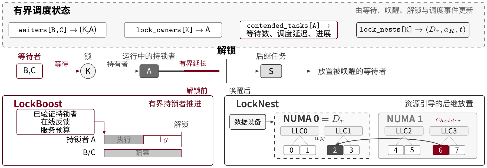
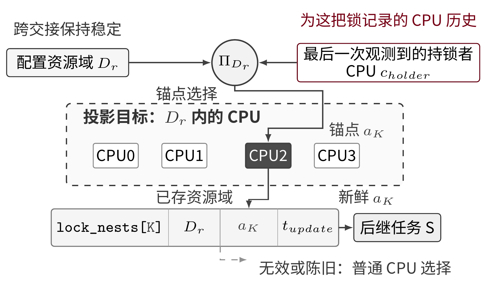
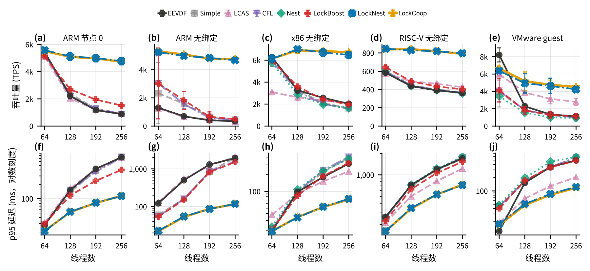
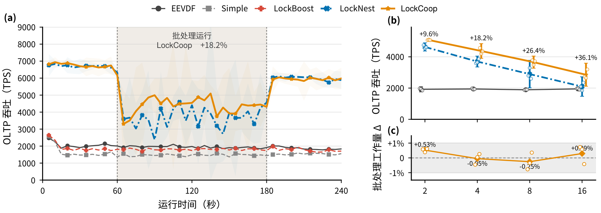
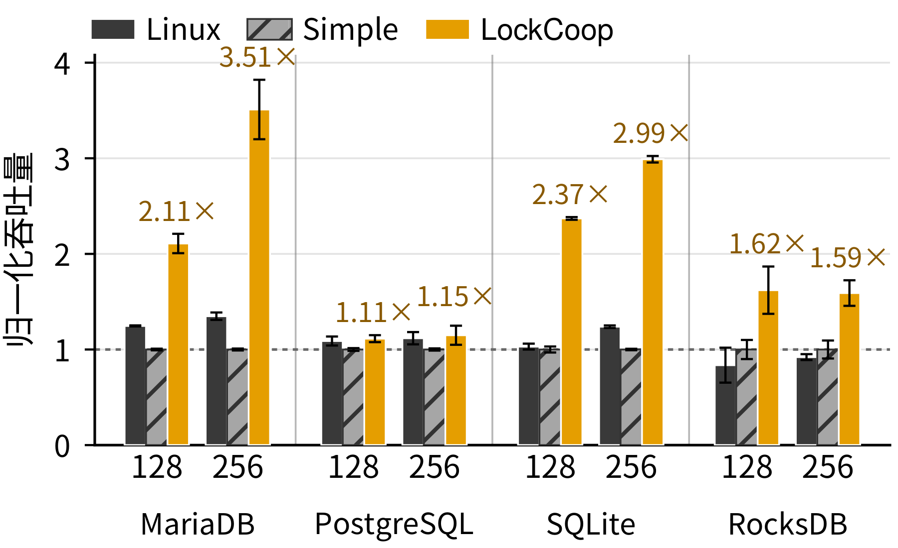

# LockCoop

面向竞争锁交接前后的 Linux sched_ext 调度机制。调度器在有界状态中保留 waiter—lock—verified owner—last owner CPU，连接解锁前的持锁者服务和唤醒后的同锁后继放置。

## 当前机制

- **LockBoost**：仅对经过验证、受到等待者依赖的持锁者提供有界时间片扩展，结合在线进展反馈控制 grant。
- **LockNest**：将同锁最近执行位置作为放置线索，以稳定资源域指导首次放置并约束锚点；队列压力、锚点失效或 CPU 不可用时回退。
- **共享观测**：覆盖锁身份、持有者证据、生命周期及作用域；普通 futex wait/wake 不能单独证明锁所有权。

## 实验结果

在 256 线程 MariaDB OLTP 实验中，相对 `scx_simple`，openEuler ARM64 节点 0 吞吐为 **5.30 倍**、p95 降低 **84.8%**；x86 全机不绑定为 **4.14 倍**、p95 降低 **82.2%**；RISC-V 为 **2.15 倍**、p95 降低 **56.6%**。论文汇总使用各平台的 scx_simple 基线；ARM64 和 x86 含后续机制复测，具体批次与数据文件见[结果说明](../../docs/benchmarks.md#lockcoop)。

在 x86 CPU 干扰实验中，LockCoop 相对仅启用 LockNest 的吞吐增加 **9.6%–36.1%**，批处理完成工作量差异不超过 **0.53%**。ARM64 全机资源域锚定相对首次观测锚点的吞吐为 **2.69 倍**，轮间 CV 从 **18.19%** 降至 **4.41%**。新增 PostgreSQL、SQLite、RocksDB 等应用对照，体现不同锁路径和共置压力下的适用性。

## 源码与复现

| 内容 | 位置 |
| --- | --- |
| 组合调度器与 loader | `src/sched_ext/scx_lockcoop.bpf.c`、`scx_lockcoop.c` |
| 拆分机制 | `src/sched_ext/scx_lockboost*.c`、`scx_locknest*.c` |
| 共享锁观测 | `src/sched_ext/include/scx/lock_observe.bpf.h` |
| 用户同步观测库 | `src/sched_ext/lockcoop_user_sync.c` |
| MariaDB、futex、owner 微基准 | `scripts/`、`benchmarks/` |
| 论文表格数据 | `../../tests/lockcoop/paper-data/` |
| 实验记录 | `../../tests/lockcoop/records/` |

[论文](../../papers/E1-LockCoop.pdf)及[补充附录](../../papers/E1-LockCoop-补充附录.pdf)说明实验环境、消融和适用边界。构建与运行命令见[项目构建说明](../../docs/构建与运行.md)。
